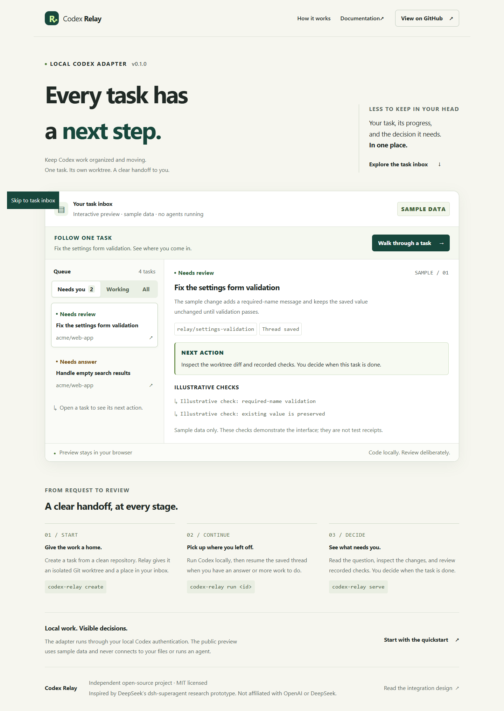
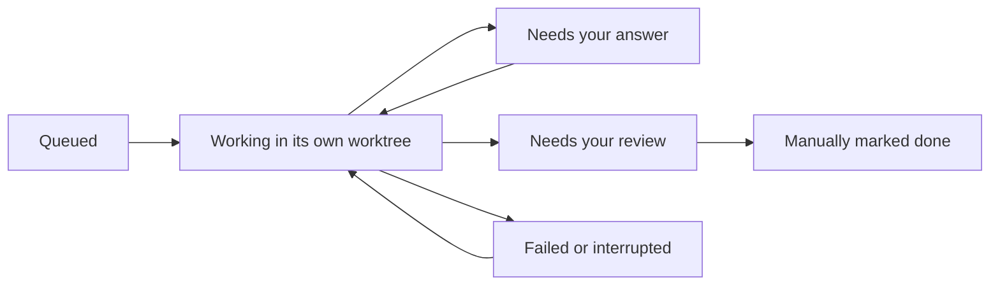

# Codex Relay

**Every task has a next step.**

A local Codex plugin that keeps coding tasks, questions and reviews together inside Codex. Each task gets an isolated Git worktree and a saved Codex thread.

## Open inside Codex (v0.3.0)

After installing the plugin, open [Codex Relay](codex://plugins/codex-relay@relay-local/app/relay_open), or ask **“Open Codex Relay.”** Relay registers a global app entrypoint and a conversation panel. The UI is a bundled MCP App connected through the host plugin bridge; the native flow starts no localhost web server.

Use **New task**, enter a repository folder and request, then choose **Run with Codex**. Answer questions with **Send & continue**, stop work with **Stop run**, inspect **Review changes**, and choose **Mark reviewed & done** after inspection. State updates automatically. Normal use requires no terminal commands or external browser.

Coding runs in saved SDK threads, separate from the current conversation. Tasks persist across plugin restarts. The earlier browser panel and CLI remain optional fallbacks. See [native installation and evidence](docs/NATIVE.md) for prerequisites, host compatibility, and the exact verification scope.

[Explore the interactive preview](https://zrk222.github.io/codex-relay/) · [Integration design](docs/INTEGRATION.md) · [Verification scope](docs/VERIFICATION.md)

The public preview uses **sample data**. It does not run agents or connect to your machine. Real coding runs locally through your existing Codex authentication.



## Quickstart

Requires Node.js 22.19+, Git, a native Codex executable on PATH, and local Codex authentication. This is a GitHub source/plugin release; it has not been published to npm or the official plugin directory.

```sh
git clone https://github.com/zrk222/codex-relay.git
cd codex-relay
npm ci
npm run build:native
codex plugin marketplace add .
codex plugin add codex-relay@relay-local
```

Reopen Codex if it has not refreshed its plugin list. Open the Relay plugin app, then use **New task → Run with Codex → Send & continue → Review changes → Mark reviewed & done**. Setup commands are one-time; task interaction is visual. Authenticate with `codex login` if your machine is not already signed in.

For the optional CLI fallback, run `npm link`. The following commands are also available:

Create a task from a **clean repository root**. Keep Relay's state directory outside that repository.

```sh
codex-relay create --repo /path/to/project --title "Fix form validation" --prompt "Reject an empty name and run the relevant tests."
codex-relay run TASK_ID
codex-relay serve
```

The create command prints a full UUID. Use that UUID as `TASK_ID`. Windows paths can be quoted, for example `--repo "C:\Projects\my-app"`.

When a task needs your decision, resume the same saved Codex thread:

```sh
codex-relay run TASK_ID --reply "Empty names should show a required-name message."
codex-relay show TASK_ID
codex-relay done TASK_ID
```

`done` is a manual acknowledgement and is allowed only from `needs_review`. It does not approve a pull request, merge code, or deploy anything. Review the worktree and the actual test outputs first.

## What happens to a task



- **Persistence:** private JSON records retain task scope, branch, worktree, thread ID, result, and reported checks.
- **Resumption:** `run` starts a thread once and resumes its saved ID on subsequent turns.
- **Exclusive execution:** a task lock refuses simultaneous runs. A crash leaves a lock; `recover TASK_ID` refuses to release it while the recorded process is alive.
- **Visual supervision:** the native plugin uses validated MCP tools and polls task state. The optional `gui` command starts the older authenticated browser panel; `serve` is read-only.
- **Explicit results:** Codex returns a structured `needs_answer` or `needs_review` result. Agent-reported checks are labelled; they are not independently verified receipts.

State defaults to `~/.codex-relay`. Override it with `CODEX_RELAY_HOME` or `--state PATH` on every command. Worktrees remain on disk until you deliberately remove them with Git after preserving their work; Relay never automatically deletes them.

## Permissions and limits

The adapter requests `workspace-write`, `approvalPolicy: never`, disabled sandbox network access, and disabled web search. Permission-requiring operations fail rather than prompting. Repository instructions and your configured Codex tools still apply. A Git worktree is **not an OS security boundary**; use a dedicated account or container for untrusted repositories. The adapter inherits your Codex configuration and does not disable or audit every configured MCP tool.

Relay does not include automatic GitHub intake, a continuously running worker queue, a hosted agent, or automatic merging. Use **Stop run** to cancel. After a crash, inspect the worktree and use **Recover stopped run** before resuming. Local task text and model output may contain private data; keep the state directory private and out of Git.

Codex usage follows your account's access and limits. No productivity or cost improvement has been measured. The preview is a demonstration of the interface, not a recording of a real coding run.

## Development

```sh
npm ci
npm test
npm run check
npm run smoke
```

`npm test` uses deterministic adapter fixtures and temporary Git repositories without a provider call. `npm run smoke` runs one real local Codex coding turn in a temporary repository and requires your authentication; it consumes normal account usage. See [verification](docs/VERIFICATION.md) for the exact scope and remaining limits.

## Inspiration and license

Inspired by [DeepSeek's dsh-superagent-prototype](https://github.com/deepseek-ai/dsh-superagent-prototype), reviewed at commit `6337fc823ce20251c8de8085948165c81aaa701e`. Relay adapts its supervision ideas into a smaller Codex-native workflow; it is not a DSH plugin or a claim of full behavioral parity. [MIT licensed](LICENSE). Independent project; not affiliated with OpenAI or DeepSeek.
