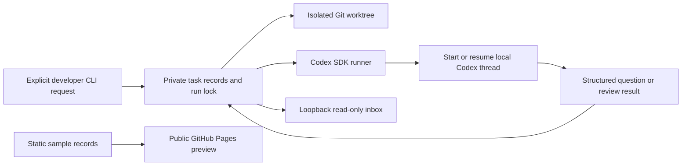

# From dsh-superagent to Codex Relay

The reusable idea is durable work with a clear next action. A developer should be able to leave a task, return to the same context, and immediately see whether the task needs a decision, review, or recovery.

## Source review

Reviewed DeepSeek's public prototype at commit `6337fc823ce20251c8de8085948165c81aaa701e`. Its README explicitly describes research code. The source includes a policy-controlled intake pipeline, persistent tickets, independent executor sessions, follow-up ownership, and a panel prioritizing tasks waiting for a person.

REA parsed 177 JavaScript/TypeScript source files without parse failures. Semantic graph coverage was partial and resource-limited. These are static observations, not runtime testing or proof of equivalence. Direct inspection of the source verified the following boundaries:

| Upstream component | Relevant behavior | Relay choice |
| --- | --- | --- |
| `src/core/ports.ts` | Executor operations start, deliver, stop | A small local run/resume adapter |
| `src/core/stage.ts` | Classifies work by what it waits for | Explicit persisted needs-answer/review/failure states |
| `src/app/views/overview.ts` | Prioritizes tickets waiting for a person | Needs-you queue filter |
| `src/executor/dsh.ts` | Persistent DSH session per ticket and queued work | Saved Codex thread ID per task |
| `src/app/runtime.ts` | Constructs DshExecutor and DSH assessor sessions | Separate Codex-native host; no drop-in compatibility claim |
| `src/app/sessions.ts` | Installs full-access DSH presets | Workspace-write Codex execution settings |

The upstream Executor interface is a useful seam for a larger DSH bridge, but swapping it alone would leave the assessor, session services, and UI host tied to DSH. Relay therefore reproduces the small supervision workflow around Codex, without importing that runtime.

## Architecture

Task writes go through the CLI. The browser has no run endpoint. The public preview has no connection to the local store. `needs_review` is model output; manual `done` is a developer acknowledgement. Neither is a deployment or GitHub approval receipt.

The SDK suits foreground jobs and saved threads. A later interactive client needing live approval dialogs and streamed chat should use the [Codex App Server](https://learn.chatgpt.com/docs/app-server). See the [official Codex SDK documentation](https://learn.chatgpt.com/docs/codex-sdk) for the supported programmatic interface.

## Useful next integrations

1. Project-specific Code Factory checks can remain in repository AGENTS.md. Relay asks Codex to follow those rules and list exact checks, while independent receipts remain the release authority.
2. GitHub issue intake could create explicit queued tasks after checking sender authorization and deduplication. It requires a separate connector and credential policy.
3. A background scheduler could resume eligible work after a process restart. It needs crash-safe dispatch and cancellation tests; this release intentionally runs one foreground turn per command.

These are proposed extensions, not shipped capabilities. No workflow or permission is activated by this document.
